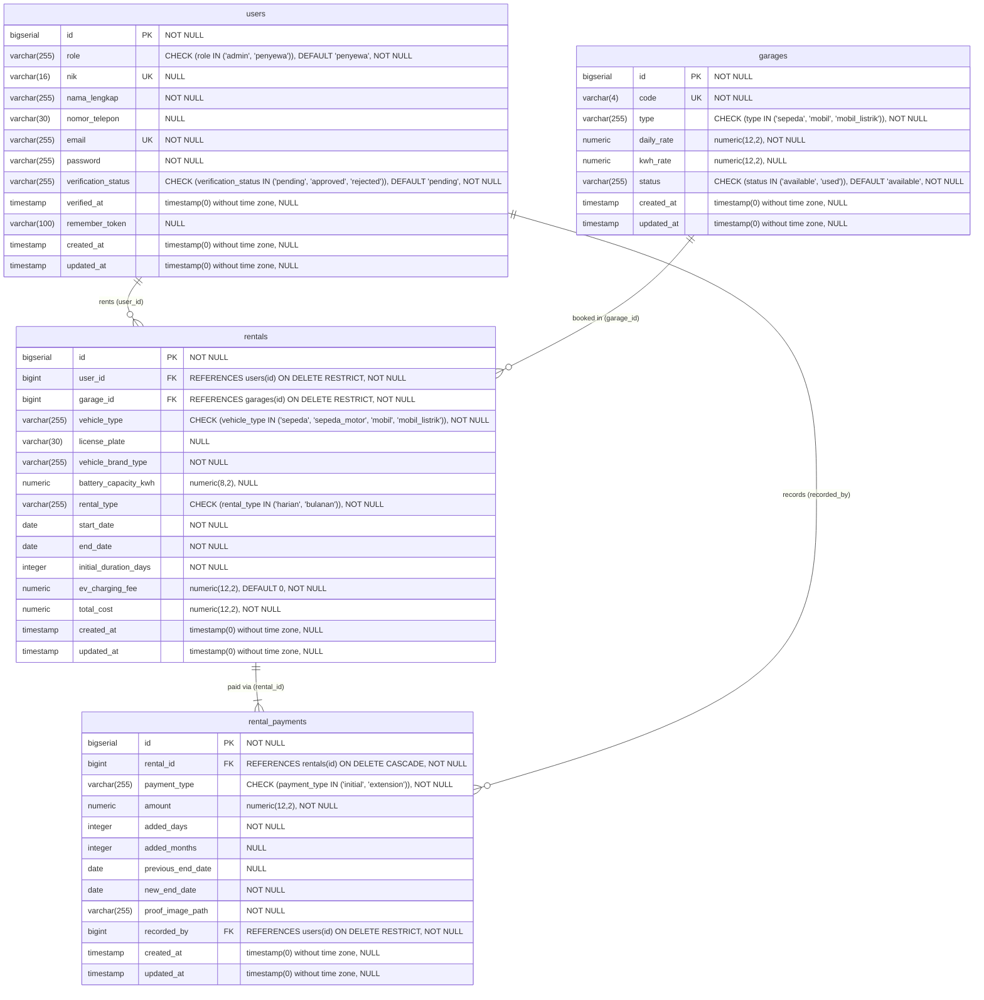

# Architecture & Database Diagrams

This document reflects the actual implemented schema and PHP classes in this Laravel + PostgreSQL application (`database/migrations/`, `app/Models/`, `app/Services/`, and `app/Http/Controllers/`).

---

## 1. Entity Relationship Diagram (PostgreSQL)

> **PostgreSQL type notes:**
> - Laravel `$table->id()` compiles to `bigserial` (`bigint` primary key backed by a sequence).
> - Laravel `$table->enum(...)` compiles on PostgreSQL to `varchar(255)` with a `CHECK (...)` constraint.
> - Laravel `$table->decimal(p, s)` compiles on PostgreSQL to `numeric(p, s)` (precision and scale are noted in column comments to keep Mermaid `erDiagram` syntax valid).
> - Laravel `$table->unsignedInteger(...)` compiles on PostgreSQL to `integer`.
> - Laravel `$table->timestamp(...)` / `$table->timestamps()` compile to `timestamp(0) without time zone`.
> - Default Laravel framework tables (`password_reset_tokens`, `sessions`, `cache`, `cache_locks`, `jobs`, `job_batches`, `failed_jobs`, `migrations`) are omitted as they are not referenced by application tables.

### Indexes & Referential Actions

| Table | Indexes | Foreign Keys |
| :--- | :--- | :--- |
| `users` | `UNIQUE(nik)`, `UNIQUE(email)`, `INDEX(role, verification_status)` | — |
| `garages` | `UNIQUE(code)`, `INDEX(type, status)` | — |
| `rentals` | `INDEX(start_date, end_date)`, `INDEX(garage_id, user_id)`, `INDEX(user_id)` | `user_id -> users.id (RESTRICT)`, `garage_id -> garages.id (RESTRICT)` |
| `rental_payments` | `INDEX(rental_id, payment_type)` | `rental_id -> rentals.id (CASCADE)`, `recorded_by -> users.id (RESTRICT)` |

---

## 2. Class Diagram (Controllers, Services, Models)

> **Diagram notes:**
> - Grouped by architectural layer: `Controllers` (`App\Http\Controllers`), `AdminControllers` (`App\Http\Controllers\Admin`), `TenantControllers` (`App\Http\Controllers\Tenant`), `Services` (`App\Services`), and `Models` (`App\Models`).
> - Solid arrows (`-->`) denote injected service associations or Eloquent model associations; dashed arrows (`..>`) denote method-level dependencies (queries, model creation/updates, validation, or constant usage).
> - Inherited Laravel framework boilerplate and the empty abstract base `Controller` are omitted; `__construct` is shown where dependency injection is declared.

```mermaid
classDiagram
    namespace Controllers {
        class AuthController {
            -TenantRegistrationService $registrationService
            +__construct(TenantRegistrationService $registrationService)
            +showLogin() View
            +login(LoginRequest $request) RedirectResponse
            +showRegister(Request $request) View|RedirectResponse
            +register(RegisterTenantRequest $request) RedirectResponse
            +logout(Request $request) RedirectResponse
        }
    }

    namespace AdminControllers {
        class GarageController {
            -GarageAvailabilityService $availabilityService
            -GarageBatchService $batchService
            +__construct(GarageAvailabilityService $availabilityService, GarageBatchService $batchService)
            +index() View
            +store(StoreGarageBatchRequest $request) RedirectResponse
        }

        class VerificationController {
            +index() View
            +approve(User $user) RedirectResponse
            +reject(User $user) RedirectResponse
        }

        class ExtensionController {
            -GarageAvailabilityService $availabilityService
            -RentalExtensionService $extensionService
            +__construct(GarageAvailabilityService $availabilityService, RentalExtensionService $extensionService)
            +index() View
            +show(Rental $rental) View|RedirectResponse
            +store(ExtendRentalRequest $request, Rental $rental) RedirectResponse
        }

        class ReportController {
            -RentalReportService $reportService
            +__construct(RentalReportService $reportService)
            +index(Request $request) View
        }
    }

    namespace TenantControllers {
        class AccountStatusController {
            +show(Request $request) View
        }

        class RentalController {
            -GarageAvailabilityService $availabilityService
            -RentalPricingService $pricingService
            -RentalService $rentalService
            +__construct(GarageAvailabilityService $availabilityService, RentalPricingService $pricingService, RentalService $rentalService)
            +create() View
            +store(StoreRentalRequest $request) RedirectResponse
        }
    }

    namespace Services {
        class TenantRegistrationService {
            +register(array $data) User
        }

        class GarageAvailabilityService {
            +today() Carbon
            +syncStatuses(?Carbon $today = null) int
            +getAvailableGarages(?string $type = null, ?Carbon $today = null) Collection
            +getActiveRentals(?Carbon $today = null) Collection
        }

        class GarageBatchService {
            -int ADVISORY_LOCK_KEY$
            +createBatch(string $type, int $quantity, float|int|string $dailyRate, float|int|string|null $kwhRate = null) Collection
        }

        class RentalPricingService {
            +int MONTHLY_DAY_MULTIPLIER$
            +array ALLOWED_GARAGE_TYPES$
            +allowedGarageTypes(string $vehicleType) array
            +isCompatible(string $vehicleType, string $garageType) bool
            +requiresLicensePlate(string $vehicleType) bool
            +requiresBatteryCapacity(string $vehicleType) bool
            +maxDailyDays(Carbon $startDate) int
            +calculateInitialDurationDays(string $rentalType, Carbon $startDate, ?int $jumlahHari = null) int
            +calculateInitialEndDate(Carbon $startDate, int $durationDays) Carbon
            +calculateMonthlyBaseRate(Garage $garage) string
            +calculateEvChargingFee(Garage $garage, string $vehicleType, float|int|string|null $batteryCapacityKwh) string
            +calculateInitialQuote(Garage $garage, string $vehicleType, string $rentalType, ?int $jumlahHari = null, float|int|string|null $batteryCapacityKwh = null, ?Carbon $startDate = null) array
            +multiplyMoney(float|int|string $left, float|int|string $right) string
            +addMoney(float|int|string $left, float|int|string $right) string
            -normalizeDecimal(float|int|string $value, int $scale) string
        }

        class RentalService {
            -GarageAvailabilityService $availabilityService
            -RentalPricingService $pricingService
            +__construct(GarageAvailabilityService $availabilityService, RentalPricingService $pricingService)
            +createRental(User $tenant, array $data) Rental
        }

        class RentalExtensionService {
            -GarageAvailabilityService $availabilityService
            -RentalPricingService $pricingService
            +__construct(GarageAvailabilityService $availabilityService, RentalPricingService $pricingService)
            +calculateExtensionQuote(Rental $rental, array $data, ?Carbon $today = null) array
            +extend(Rental $rental, User $admin, array $data) RentalPayment
        }

        class RentalReportService {
            +generate(array $filters = []) array
            -baseQuery(array $filters) Builder
            -monthExpression() string
            -dateExpression() string
            -formatCurrency(mixed $value) string
            -emptyToNull(mixed $value) mixed
        }
    }

    namespace Models {
        class User {
            +string ROLE_ADMIN$
            +string ROLE_PENYEWA$
            +string STATUS_PENDING$
            +string STATUS_APPROVED$
            +string STATUS_REJECTED$
            #array $fillable
            #array $hidden
            #casts() array
            +rentals() HasMany
            +recordedPayments() HasMany
            +isAdmin() bool
            +isPenyewa() bool
            +isPending() bool
            +isApproved() bool
            +isRejected() bool
            +scopePenyewa(Builder $query) Builder
            +scopePending(Builder $query) Builder
            +scopeApproved(Builder $query) Builder
            +scopeRejected(Builder $query) Builder
        }

        class Garage {
            +string TYPE_SEPEDA$
            +string TYPE_MOBIL$
            +string TYPE_MOBIL_LISTRIK$
            +array TYPES$
            +array PREFIX_BY_TYPE$
            +string STATUS_AVAILABLE$
            +string STATUS_USED$
            +int GLOBAL_MAX_CAPACITY$
            #array $fillable
            #casts() array
            +rentals() HasMany
            +activeRentals() HasMany
            +isAvailable() bool
            +isUsed() bool
            +isEvGarage() bool
            +scopeAvailable(Builder $query) Builder
            +scopeUsed(Builder $query) Builder
            +scopeOfType(Builder $query, string $type) Builder
        }

        class Rental {
            +string VEHICLE_SEPEDA$
            +string VEHICLE_SEPEDA_MOTOR$
            +string VEHICLE_MOBIL$
            +string VEHICLE_MOBIL_LISTRIK$
            +array VEHICLE_TYPES$
            +string TYPE_HARIAN$
            +string TYPE_BULANAN$
            +array RENTAL_TYPES$
            #array $fillable
            #casts() array
            +user() BelongsTo
            +garage() BelongsTo
            +payments() HasMany
            +isActiveOn(?Carbon $date = null) bool
            +scopeActiveOn(Builder $query, Carbon $date) Builder
            +scopeActiveToday(Builder $query) Builder
        }

        class RentalPayment {
            +string TYPE_INITIAL$
            +string TYPE_EXTENSION$
            +array PAYMENT_TYPES$
            #array $fillable
            #casts() array
            +rental() BelongsTo
            +recorder() BelongsTo
        }
    }

    %% Controller -> Service (Dependency Injection)
    AuthController --> TenantRegistrationService
    GarageController --> GarageAvailabilityService
    GarageController --> GarageBatchService
    ExtensionController --> GarageAvailabilityService
    ExtensionController --> RentalExtensionService
    ReportController --> RentalReportService
    RentalController --> GarageAvailabilityService
    RentalController --> RentalPricingService
    RentalController --> RentalService

    %% Controller -> Model (Direct Usage)
    AuthController ..> User : authenticates
    GarageController ..> Garage : lists
    VerificationController ..> User : verifies
    ExtensionController ..> Rental : views and extends
    ReportController ..> User : lists tenants
    ReportController ..> Rental : queries years
    AccountStatusController ..> User : shows status
    RentalController ..> Garage : maps available
    RentalController ..> Rental : confirms booking

    %% Service -> Service (Dependency Injection)
    RentalService --> GarageAvailabilityService
    RentalService --> RentalPricingService
    RentalExtensionService --> GarageAvailabilityService
    RentalExtensionService --> RentalPricingService

    %% Service -> Model (Domain Operations)
    TenantRegistrationService ..> User : registers
    GarageAvailabilityService ..> Garage : syncs and queries
    GarageAvailabilityService ..> Rental : queries active
    GarageBatchService ..> Garage : batch creates
    RentalPricingService ..> Garage : reads rates
    RentalPricingService ..> Rental : uses constants
    RentalService ..> User : validates tenant
    RentalService ..> Garage : locks and marks used
    RentalService ..> Rental : creates
    RentalService ..> RentalPayment : creates initial
    RentalExtensionService ..> User : validates admin
    RentalExtensionService ..> Rental : locks and updates
    RentalExtensionService ..> RentalPayment : creates extension
    RentalReportService ..> Rental : aggregates
    RentalReportService ..> Garage : joins and validates
    RentalReportService ..> User : joins tenants

    %% Model -> Model (Eloquent Relationships)
    User "1" --> "0..*" Rental : rentals
    Garage "1" --> "0..*" Rental : rentals
    Rental "1" --> "1..*" RentalPayment : payments
    User "1" --> "0..*" RentalPayment : recordedPayments
```

